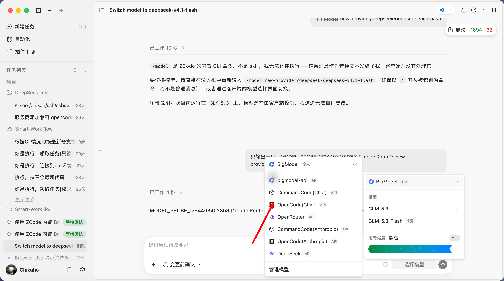
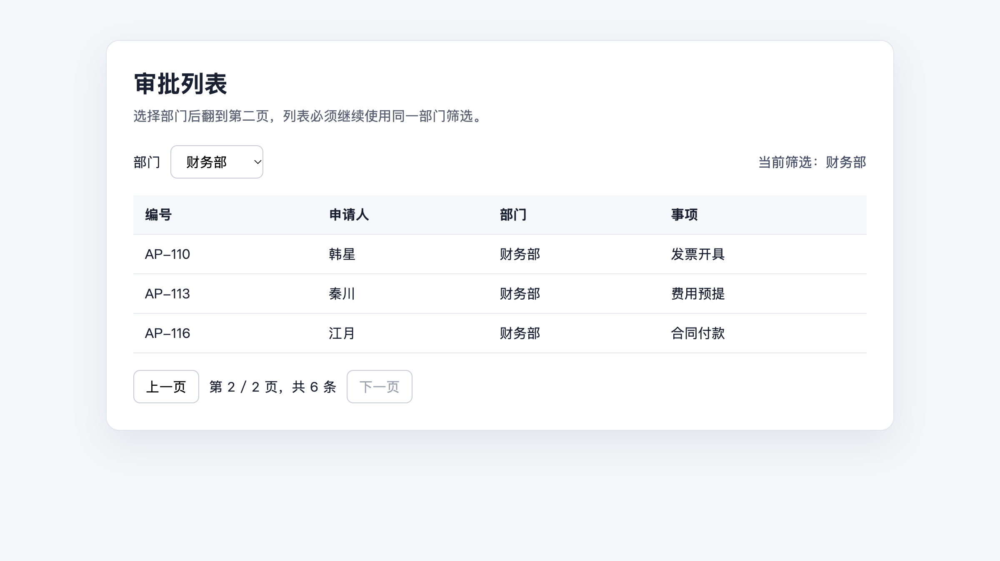

# Smart-WorkFlow-Agent

在 Pi 里选择 ZCode 或 DeepSeek Harness，让桌面应用执行任务，并在你看得见的浏览器里完成验证。

## 开始前准备

| 需要安装 | 用途 |
|---|---|
| macOS | 当前桌面控制和应用路径按 macOS 实现 |
| Node.js `22.19.0+` | 运行项目 |
| Google Chrome | 显示任务执行和验收页面 |
| OCX `2.100.1` | 提供模型和路由；必须保持运行 |
| ZCode Desktop 或 DeepSeek Harness Desktop | 实际执行任务 |
| Smart-WorkFlow-Agent-Workspace | 提供任务规则和验收规则 |

已验证的桌面版本：

- [ZCode Desktop `3.17.2`](https://github.com/zai-org/zcode/releases)
- [DeepSeek Harness Desktop `0.2.2-rc.1`](https://github.com/deepseek-ai/deepseek-harness/releases)

## 安装项目

```bash
git clone https://github.com/Chikaaho/Smart-WorkFlow-Agent.git
cd Smart-WorkFlow-Agent
npm ci --ignore-scripts
npm --prefix packages/workflow-agent run build
```

安装并启动 OCX：

```bash
npm install -g @bitkyc08/opencodex@2.100.1
ocx setup
ocx start
ocx status --json
```

看到下面两个值才算启动成功：

```text
proxy.running = true
proxy.health.ok = true
```

OCX 没有启动时，Pi 不会把任务交给 ZCode 或 DeepSeek Harness。

## 安装桌面应用

选择一个桌面应用即可：

### ZCode

1. 打开 [ZCode Releases](https://github.com/zai-org/zcode/releases)。
2. 下载与你的 Mac 芯片对应的安装包。
3. 把 ZCode 放入“应用程序”目录并启动一次。
4. 确认应用路径为 `/Applications/ZCode.app`。

### DeepSeek Harness

1. 打开 [DeepSeek Harness Releases](https://github.com/deepseek-ai/deepseek-harness/releases)。
2. 下载 macOS 安装包。
3. 把 DeepSeek Harness 放入“应用程序”目录并启动一次。
4. 确认应用路径为 `/Applications/DeepSeek Harness.app`。

如果应用安装在其他位置，需要修改对应示例文件顶部的应用路径。

## 设置本机路径

把下面三个路径改成你自己的：

```bash
export AGENT_REPO="/absolute/path/to/Smart-WorkFlow-Agent"
export TARGET_WORKSPACE="/absolute/path/to/your-project"
export SMART_WORKFLOW_GOVERNANCE_ROOT="/absolute/path/to/Smart-WorkFlow-Agent-Workspace"
export SMART_WORKFLOW_CONFIG="$TARGET_WORKSPACE/workflow.config.yaml"
```

- `AGENT_REPO`：本仓库路径。
- `TARGET_WORKSPACE`：要处理的项目路径。
- `SMART_WORKFLOW_GOVERNANCE_ROOT`：Workspace 规则仓库的 `main` 工作树路径。

## 使用 ZCode

### 1. 在 ZCode 中准备模型

先在 ZCode 的模型设置中加入要使用的 OCX 模型服务。当前已经验证：

| 在配置文件中填写 | ZCode 中选择 |
|---|---|
| `opencode-go/deepseek-v4.1-flash` | `OpenCode(Chat) / deepseek-v4.1-flash` |
| `command-code/deepseek-deepseek-v4.1-flash` | `CommandCode(Chat) / deepseek/deepseek-v4.1-flash` |



### 2. 复制 ZCode 配置

```bash
cp "$AGENT_REPO/examples/workflow-extension/workflow.config.example.yaml" \
  "$TARGET_WORKSPACE/workflow.config.yaml"
```

默认配置使用 OpenCode(Chat)。运行命令时加上 `ui`，会改用 CommandCode(Chat)：

```yaml
schemaVersion: 1
harness: zcode
modelGateway:
  type: opencodex
  required: true
  installIfMissing: false

roles:
  planner:
    model: gpt-6-luna
  executor:
    model: opencode-go/deepseek-v4.1-flash
  admin:
    model: gpt-6-luna

executors:
  ui:
    model: command-code/deepseek-deepseek-v4.1-flash
```

模型账号和密钥继续保存在 OCX 与 ZCode 中，不要写进这个 YAML 文件。

### 3. 启动 ZCode 工作流

```bash
cd "$TARGET_WORKSPACE"
"$AGENT_REPO/pi-test.sh" \
  --extension "$AGENT_REPO/examples/workflow-extension/zcode-protocol-workflow.ts"
```

进入 Pi 后，使用默认模型运行：

```text
/workflow-p1-zcode
```

使用 CommandCode(Chat) 的 DeepSeek 运行：

```text
/workflow-p1-zcode ui
```

Pi 会检查 OCX，读取配置，在 ZCode 中选择对应模型，然后让 ZCode 操作可见 Chrome。任务完成后，结果会回到 Pi。

### 4. 单独测试模型切换

启动模型切换工具：

```bash
cd "$TARGET_WORKSPACE"
"$AGENT_REPO/pi-test.sh" \
  --extension "$AGENT_REPO/examples/workflow-extension/zcode-desktop-control.ts"
```

进入 Pi 后运行：

```text
/harness-zcode-model-switch OpenCode(Chat)/deepseek-v4.1-flash
/harness-zcode-model-switch CommandCode(Chat)/deepseek/deepseek-v4.1-flash
```

需要同时验证模型确实能回复时运行：

```text
/harness-zcode-model-probe CommandCode(Chat)/deepseek/deepseek-v4.1-flash
```

如果 macOS 拒绝控制 ZCode，请到“系统设置 → 隐私与安全性 → 辅助功能”中允许运行 Pi 的终端应用，然后重启 Pi。

## 使用 DeepSeek Harness

DeepSeek Harness 只使用它自己的 DeepSeek 模型，不读取 ZCode 中的 OpenCode(Chat) 或 CommandCode(Chat)。

### 1. 安装浏览器插件

```bash
'/Applications/DeepSeek Harness.app/Contents/Resources/runtime/cli/bin/dsh' \
  plugin --profile desktop add --save-exact --ignore-scripts \
  @deepseek-ai/dsh-browser-use@0.2.2-rc.1 \
  @deepseek-ai/dsh-experimental-browser-use-chrome-devtools-mcp@0.2.2-rc.1
```

打开 `~/.dsh/profiles/desktop/cordis.patch.yml`，加入：

```yaml
- insert:
    - id: browser-use
      name: "@deepseek-ai/dsh-browser-use"
    - id: browser-use-chrome-devtools-mcp
      name: "@deepseek-ai/dsh-experimental-browser-use-chrome-devtools-mcp"
      config:
        mode: launch
        headless: false
        executablePath: "/Applications/Google Chrome.app/Contents/MacOS/Google Chrome"
```

保存后重启 DeepSeek Harness。

### 2. 复制 DeepSeek 配置

```bash
cp "$AGENT_REPO/examples/workflow-extension/workflow.deepseek.config.example.yaml" \
  "$TARGET_WORKSPACE/workflow.config.yaml"
```

配置中的模型保持为：

```yaml
roles:
  planner:
    model: deepseek-official/deepseek-flash
  executor:
    model: deepseek-official/deepseek-flash
  admin:
    model: deepseek-official/deepseek-flash

executors:
  ui:
    model: deepseek-official/deepseek-flash
```

### 3. 启动 DeepSeek Harness 工作流

```bash
cd "$TARGET_WORKSPACE"
"$AGENT_REPO/pi-test.sh" \
  --extension "$AGENT_REPO/examples/workflow-extension/deepseek-protocol-workflow.ts"
```

进入 Pi 后运行：

```text
/workflow-p3-deepseek
```

或：

```text
/workflow-p3-deepseek ui
```

DeepSeek Harness 会打开可见 Chromium，执行页面操作，并把结果返回 Pi。

## 跑一遍自带示例

自带示例用于检查“筛选后翻页”是否正常。

### 1. 启动测试页面

另开一个终端：

```bash
cd "$AGENT_REPO/examples/workflow-extension"
python3 -m http.server 4173
```

测试页面地址：

```text
http://127.0.0.1:4173/p0-filter-pagination-demo.html
```

### 2. 运行任务

使用前面的 ZCode 或 DeepSeek Harness 启动命令，然后在 Pi 中运行对应命令。

ZCode 桌面 Browser Use 示例还可以直接运行：

```text
/harness-p0-zcode
```

如果 ZCode 正在等待浏览器授权：

```text
/harness-zcode-approve-browser
```

### 3. 检查结果

通过时，页面应停在财务部第二页，并显示三条记录：



Pi 返回的内容应包含：

```json
{
  "department": "财务部",
  "page": "2 / 2",
  "ids": ["AP-110", "AP-113", "AP-116"]
}
```

只看到模型名称、只打开桌面应用或只生成截图，都不算通过。页面操作和返回结果必须同时正确。

## 一次任务会怎么运行

1. 你在 Pi 中运行 ZCode 或 DeepSeek Harness 命令。
2. Pi 检查 OCX、配置文件和本机应用。
3. Pi 把任务交给你选择的桌面应用。
4. 桌面应用在可见浏览器中执行操作。
5. Pi 收到执行结果并检查是否满足要求。
6. 不满足时继续修复；满足后结束任务。

你可以随时切到浏览器或桌面应用查看过程，也可以暂停后接管。

## 当前可用范围

- ZCode：模型切换、可见浏览器、任务退回、暂停和恢复已完成实机验证。
- DeepSeek Harness：原生 DeepSeek 模型和可见浏览器已完成实机验证。
- DeepSeek Harness 独立接入 Workspace 规则仓库的初始化登记仍待完成。
- 当前命令主要用于跑通仓库内置验收示例；接入实际项目时，需要按业务任务修改需求和验收项。

## 常见问题

### 提示 OCX 没有运行

```bash
ocx status --json
ocx start
```

确认 `proxy.running` 和 `proxy.health.ok` 都是 `true`。

### ZCode 找不到模型

先确认 OCX 中存在该模型：

```bash
ocx models live --json
```

再打开 ZCode 模型设置，确认对应的 OpenCode(Chat) 或 CommandCode(Chat) 已启用。

### ZCode 不能操作窗口

打开“系统设置 → 隐私与安全性 → 辅助功能”，允许运行 Pi 的终端应用，然后重新启动 Pi。

### DeepSeek Harness 没有浏览器工具

确认两个浏览器插件已经安装，`cordis.patch.yml` 中存在 `insert` 配置，然后重启 DeepSeek Harness。

### 找不到 Workspace 规则

确认下面的环境变量指向规则仓库的 `main` 工作树：

```bash
echo "$SMART_WORKFLOW_GOVERNANCE_ROOT"
```

### 4173 端口被占用

停止旧的测试服务，再重新执行：

```bash
python3 -m http.server 4173
```

## 开发者检查

```bash
npm --prefix packages/workflow-agent test
npx tsc -p packages/workflow-agent/tsconfig.build.json --noEmit
npm run check:pinned-deps
```

当前工作流包有 7 个测试文件、23 个测试。完整设计和验收记录：

- [实施方案](docs/local-harness-collaboration-plan.md)
- [实机验收记录](docs/local-harness-collaboration-acceptance-2026-11-11.md)
- [桌面应用与模型调研](docs/desktop-harness-model-capabilities-research.md)
- [工作流包说明](packages/workflow-agent/README.md)

## 数据与隐私

- 不要把模型账号、令牌或 API Key 写入 `workflow.config.yaml`。
- `.workflow/` 是本机运行数据，不要提交。
- README 中的桌面截图已经移除用户名、本机路径、项目名和会话内容。

## 上游项目

本项目基于 [earendil-works/pi](https://github.com/earendil-works/pi) fork 开发，并保留上游提交历史。

## License

MIT
