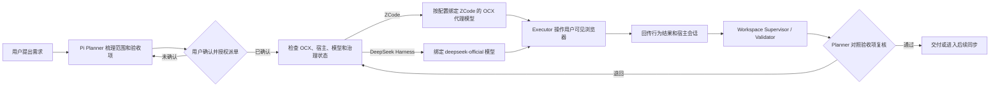

# Smart-WorkFlow-Agent

Smart-WorkFlow-Agent 是一个基于 Pi 的本地桌面 Harness 协同入口。它让 Pi 负责需求确认、派单、恢复和验收，同时把真正的模型执行与可见浏览器操作交给 ZCode 或 DeepSeek Harness。

当前实现解决四件事：

- 任务开始前强制检查本机 OCX 已安装、代理已启动且健康。
- ZCode 根据 Workspace 配置选择自身已经接入的 OCX 代理模型，可在 OpenCode(Chat)、CommandCode(Chat) 等 provider 间切换。
- DeepSeek Harness 只使用自身的 `deepseek-official` provider，不复用 ZCode 的模型配置。
- Executor 完成任务后，由 Workspace Supervisor / Validator 检查终态，再交给 Planner 按业务验收项裁决。

## 界面与验收结果

### ZCode 模型选择

下面的截图已遮盖用户名、头像、本机路径、项目名、任务记录和会话正文，只保留模型 provider 与选择器。Pi 不依赖 ZCode 当前默认模型，而是按 `workflow.config.yaml` 在创建会话时绑定目标 provider/model。


### 可见浏览器验收

测试需求是“筛选财务部后翻到第二页，筛选条件不能丢失”。通过时页面必须同时满足：部门为财务部、页码为 `2 / 2`、编号为 `AP-110`、`AP-113`、`AP-116`。


## 工作流程



模型请求、浏览器操作和回执属于同一张派单。业务验收失败才创建修复尝试；进程恢复时先读取原会话和页面状态，避免重复点击、提交或发布。

## 已验证环境

| 组件 | 已验证版本或边界 |
|---|---|
| macOS | 当前桌面驱动和应用路径按 macOS 实现 |
| Node.js | `22.19.0` 或更高 |
| ZCode Desktop | `3.17.2` |
| DeepSeek Harness Desktop | `0.2.2-rc.1` |
| OpenCodex / `ocx` | `2.100.1`，代理健康后才允许派单 |
| Google Chrome | 用户可见窗口；ZCode Browser Use 或 DeepSeek Chrome DevTools MCP |
| Workspace 治理 | 读取 `Smart-WorkFlow-Agent-Workspace` 的 `main` |

ZCode 的 P0、P1、P2 已通过真实桌面验收。DeepSeek Harness 的浏览器核心已通过；独立的 `deepseek-harness` 治理初始化登记仍是后续门禁。完整记录见[阶段验收文档](docs/local-harness-collaboration-acceptance-2026-11-11.md)。

## 安装

### 1. 拉取项目并安装依赖

```bash
git clone https://github.com/Chikaaho/Smart-WorkFlow-Agent.git
cd Smart-WorkFlow-Agent
npm ci --ignore-scripts
npm --prefix packages/workflow-agent run build
```

仓库使用 Node.js `22.19.0+`。`npm ci --ignore-scripts` 不执行第三方生命周期脚本；工作流包单独构建，不要求先构建整个 Pi monorepo。

### 2. 安装并启动 OCX

当前实测版本为 `2.100.1`：

```bash
npm install -g @bitkyc08/opencodex@2.100.1
ocx setup
ocx start
ocx status --json
```

`ocx setup` 用于配置 provider 与客户端接入。最后一条命令必须回读 `proxy.running=true` 和 `proxy.health.ok=true`。工作流每次派单前都会重新检查；OCX 未安装、未运行或不健康时，不创建 ZCode 或 DeepSeek Harness 会话。

### 3. 安装桌面宿主

按实际使用的宿主安装其桌面版：

- [ZCode Desktop Releases](https://github.com/zai-org/zcode/releases)：下载与 Mac 架构匹配的安装包，安装后应用默认位于 `/Applications/ZCode.app`。本项目已验证 `3.17.2`。
- [DeepSeek Harness Releases](https://github.com/deepseek-ai/deepseek-harness/releases)：下载对应版本的 macOS 安装包，安装后应用默认位于 `/Applications/DeepSeek Harness.app`。本项目已验证 `0.2.2-rc.1`。

当前示例按以上默认路径加载应用资源。若安装位置不同，需要同步调整对应示例入口中的应用路径。

### 4. 准备 Workspace 治理副本

准备 `Smart-WorkFlow-Agent-Workspace` 的 `main` 工作树，并记下其绝对路径。运行时通过环境变量传入，不把治理规则复制进业务项目：

```bash
export SMART_WORKFLOW_GOVERNANCE_ROOT="/absolute/path/to/Smart-WorkFlow-Agent-Workspace"
```

## 配置

配置文件放在目标 Workspace 根目录，文件名为 `workflow.config.yaml`。

### ZCode：使用 ZCode 自身的 OCX 代理模型

```bash
cp /absolute/path/to/Smart-WorkFlow-Agent/examples/workflow-extension/workflow.config.example.yaml \
  /absolute/path/to/target-workspace/workflow.config.yaml
```

核心配置如下：

```yaml
schemaVersion: 1
harness: zcode
modelGateway:
  type: opencodex
  required: true
  installIfMissing: false

roles:
  planner:
    model: gpt-6-luna
  executor:
    model: opencode-go/deepseek-v4.1-flash
  admin:
    model: gpt-6-luna

executors:
  ui:
    model: command-code/deepseek-deepseek-v4.1-flash
```

ZCode 需要先在自己的模型配置中加入对应的 OCX 代理 provider。当前已验证映射为：

| 工作流模型 | ZCode provider/model |
|---|---|
| `opencode-go/deepseek-v4.1-flash` | `OpenCode(Chat) / deepseek-v4.1-flash` |
| `command-code/deepseek-deepseek-v4.1-flash` | `CommandCode(Chat) / deepseek/deepseek-v4.1-flash` |

Pi 先从 OCX 实时目录解析公开模型 ID，再从 `~/.zcode/v2/provider_config.json` 读取实际 provider/model。账号和密钥留在 OCX 与 ZCode 中，不写入 `workflow.config.yaml`。

### DeepSeek Harness：只使用原生 DeepSeek

```bash
cp /absolute/path/to/Smart-WorkFlow-Agent/examples/workflow-extension/workflow.deepseek.config.example.yaml \
  /absolute/path/to/target-workspace/workflow.config.yaml
```

三个角色和具名 Executor 均使用原生 provider：

```yaml
schemaVersion: 1
harness: deepseek-harness
modelGateway:
  type: opencodex
  required: true
  installIfMissing: false

roles:
  planner:
    model: deepseek-official/deepseek-flash
  executor:
    model: deepseek-official/deepseek-flash
  admin:
    model: deepseek-official/deepseek-flash

executors:
  ui:
    model: deepseek-official/deepseek-flash
```

OCX 在这里仍是 Pi 的启动门禁，但不参与 DeepSeek Harness 会话选模。`command-code/*`、`opencode-go/*` 等 ZCode 路由会被拒绝。

### 为 DeepSeek Harness 安装可见浏览器插件

DeepSeek Harness Desktop `0.2.2-rc.1` 默认没有浏览器 provider。先安装与桌面版一致的插件版本：

```bash
'/Applications/DeepSeek Harness.app/Contents/Resources/runtime/cli/bin/dsh' \
  plugin --profile desktop add --save-exact --ignore-scripts \
  @deepseek-ai/dsh-browser-use@0.2.2-rc.1 \
  @deepseek-ai/dsh-experimental-browser-use-chrome-devtools-mcp@0.2.2-rc.1
```

然后在 `~/.dsh/profiles/desktop/cordis.patch.yml` 中显式挂载：

```yaml
- insert:
    - id: browser-use
      name: "@deepseek-ai/dsh-browser-use"
    - id: browser-use-chrome-devtools-mcp
      name: "@deepseek-ai/dsh-experimental-browser-use-chrome-devtools-mcp"
      config:
        mode: launch
        headless: false
        executablePath: "/Applications/Google Chrome.app/Contents/MacOS/Google Chrome"
```

保存后重启 DeepSeek Harness。只安装依赖、不写 `insert` 时，模型看不到 `mcp__chrome-devtools-mcp__*` 工具。

## 启动与运行

以下命令使用三个路径变量，避免把本机路径写入仓库：

```bash
export AGENT_REPO="/absolute/path/to/Smart-WorkFlow-Agent"
export TARGET_WORKSPACE="/absolute/path/to/target-workspace"
export SMART_WORKFLOW_GOVERNANCE_ROOT="/absolute/path/to/Smart-WorkFlow-Agent-Workspace"
export SMART_WORKFLOW_CONFIG="$TARGET_WORKSPACE/workflow.config.yaml"
```

### 1. 启动筛选翻页验收页

这是仓库内置的桌面浏览器闭环示例。另开一个终端：

```bash
cd "$AGENT_REPO/examples/workflow-extension"
python3 -m http.server 4173
```

浏览器页面为 `http://127.0.0.1:4173/p0-filter-pagination-demo.html`。

### 2. 运行 ZCode 协议链路

```bash
cd "$TARGET_WORKSPACE"
"$AGENT_REPO/pi-test.sh" \
  --extension "$AGENT_REPO/examples/workflow-extension/zcode-protocol-workflow.ts"
```

进入 Pi 后运行：

```text
/workflow-p1-zcode
```

默认使用 `roles.executor`，即 OpenCode(Chat) 的 DeepSeek。要按具名配置切换到 CommandCode(Chat)：

```text
/workflow-p1-zcode ui
```

入口会依次执行：读取配置、检查 OCX、解析 OCX 路由、回读 ZCode provider、创建 Executor 会话、操作可见 Chrome、提交 Supervisor 回执、等待 Planner 复核。

### 3. 运行 ZCode 桌面模型与 Browser Use 探针

```bash
cd "$TARGET_WORKSPACE"
"$AGENT_REPO/pi-test.sh" \
  --extension "$AGENT_REPO/examples/workflow-extension/zcode-desktop-control.ts"
```

进入 Pi 后可执行：

```text
/harness-zcode-model-switch OpenCode(Chat)/deepseek-v4.1-flash
/harness-zcode-model-switch CommandCode(Chat)/deepseek/deepseek-v4.1-flash
/harness-zcode-model-probe CommandCode(Chat)/deepseek/deepseek-v4.1-flash
/harness-p0-zcode
```

第一次运行若被 macOS 拒绝，需要在“系统设置 → 隐私与安全性 → 辅助功能”中允许运行 Pi 的终端应用，然后重启 Pi。ZCode 弹出 Browser Use 确认时，可在 Pi 中执行：

```text
/harness-zcode-approve-browser
```

### 4. 运行 DeepSeek Harness 链路

先确保目标 Workspace 使用 DeepSeek 配置，再启动：

```bash
cd "$TARGET_WORKSPACE"
"$AGENT_REPO/pi-test.sh" \
  --extension "$AGENT_REPO/examples/workflow-extension/deepseek-protocol-workflow.ts"
```

进入 Pi 后运行：

```text
/workflow-p3-deepseek
```

或指定具名 Executor：

```text
/workflow-p3-deepseek ui
```

Pi 会启动 DeepSeek Desktop Host，创建会话，通过 `session/selectModel` 绑定并回读 `deepseek-official/deepseek-flash`，再要求会话只使用 Chrome DevTools MCP 操作可见 Chromium。

## 通过标准

筛选翻页示例的有效结果必须同时包含：

```json
{
  "department": "财务部",
  "page": "2 / 2",
  "ids": ["AP-110", "AP-113", "AP-116"]
}
```

目录中能看到模型、桌面应用已经打开、或者只得到静态截图，都不能代替真实推理、工具调用、页面操作和结果回读。详细证据见[验收记录](docs/local-harness-collaboration-acceptance-2026-11-11.md)。

## 项目结构

```text
packages/workflow-agent/
  src/config.ts                  workflow.config.yaml 校验
  src/ocx.ts                     OCX 状态、目录与路由解析
  src/workflow.ts                确认、派单、退回、暂停和恢复
  src/workspace.ts               Supervisor / Validator 事件桥接
  src/desktop/zcode-*.ts         ZCode 模型与 app-server 协议
  src/desktop/deepseek-*.ts      DeepSeek Desktop Host 协议
  src/desktop/cdp-browser.ts     用户可见 Chrome provider
  test/                          定向单元测试

examples/workflow-extension/
  workflow.config.example.yaml
  workflow.deepseek.config.example.yaml
  zcode-protocol-workflow.ts
  deepseek-protocol-workflow.ts
  zcode-desktop-control.ts
  p0-filter-pagination-demo.html

docs/
  local-harness-collaboration-plan.md
  local-harness-collaboration-acceptance-2026-11-11.md
  desktop-harness-model-capabilities-research.md
```

## 开发与检查

工作流包的定向检查：

```bash
npm --prefix packages/workflow-agent test
npx tsc -p packages/workflow-agent/tsconfig.build.json --noEmit
npm run check:pinned-deps
```

全仓检查：

```bash
npm run check
```

当前工作流包 7 个测试文件、23 个测试已通过。全仓检查中的既有 `packages/ai/test` 模型目录漂移单独记录在[验收文档](docs/local-harness-collaboration-acceptance-2026-11-11.md)，不应被误报成工作流包通过。

## 常见问题

### Pi 提示 OCX 未安装或代理未运行

```bash
ocx status --json
ocx start
```

确认 `proxy.running` 和 `proxy.health.ok` 均为 `true`，再重新派单。

### ZCode 找不到配置中的模型

先用 `ocx models live --json` 确认公开模型 ID 已启用，再检查 `~/.zcode/v2/provider_config.json` 中是否存在对应 provider/model。工作流不会静默改用其他模型。

### DeepSeek Harness 没有浏览器工具

检查两个插件版本与桌面版一致，并确认 `cordis.patch.yml` 使用了 `insert`。修改后需要重启 DeepSeek Harness。

### 找不到 Workspace 治理

确认 `SMART_WORKFLOW_GOVERNANCE_ROOT` 指向治理仓库的 `main` 工作树，且目标 Workspace 对该目录具有只读访问权限。

### 4173 端口已被占用

验收示例固定访问 `127.0.0.1:4173`。停止占用该端口的旧测试服务，再重新运行 `python3 -m http.server 4173`。

## 隐私与凭据

- 不要把 OCX、ZCode、DeepSeek Harness 的账号、令牌或 API Key 写入仓库配置。
- README 截图已遮盖用户名、头像、本机路径、项目名、任务记录和会话内容。
- `.workflow/` 中的运行状态和 Supervisor 数据属于 Workspace 本地数据，不应提交。
- 浏览器必须由选定的桌面 Harness 控制；本会话直接操作浏览器不能作为产品验收证据。

## 相关文档

- [实施与验收方案](docs/local-harness-collaboration-plan.md)
- [实机验收记录](docs/local-harness-collaboration-acceptance-2026-11-11.md)
- [桌面 Harness 与模型能力调研](docs/desktop-harness-model-capabilities-research.md)
- [工作流包 API 说明](packages/workflow-agent/README.md)

## 上游项目

本项目基于 [earendil-works/pi](https://github.com/earendil-works/pi) fork 开发，并保留上游提交历史。上游 Pi 的通用 CLI、SDK、扩展和 TUI 文档请从该链接查看。

## License

MIT
