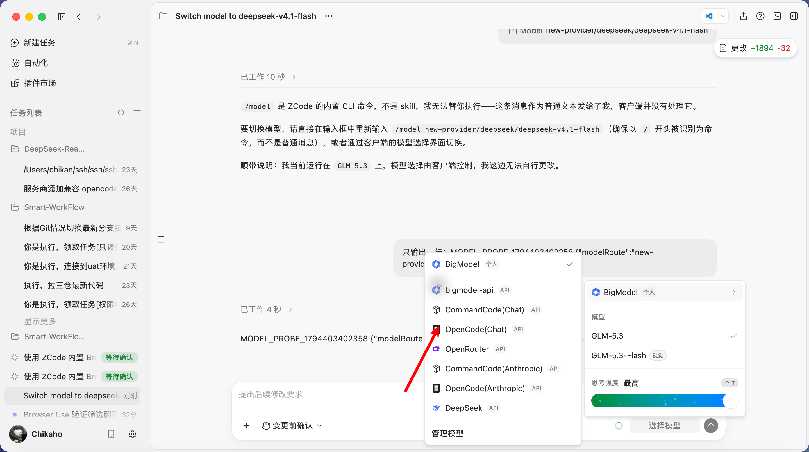
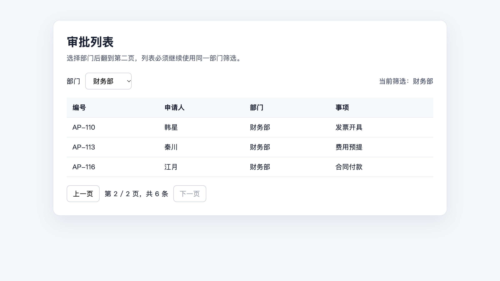

# @earendil-works/pi-workflow-agent

Pi 的桌面 Harness 工作流核心。它提供：

- `workflow.config.yaml` 校验、OCX 安装/运行门禁与模型路由解析；
- 需求确认、Executor 委派、退回、暂停、接管、取消和恢复状态机；
- 使用 `roles.planner` 模型独立读取行为证据、逐项验收，并把退回意见转成下一次 Executor 派单；
- 将每次状态变化、Executor 回执和 Planner 结论写入 `WorkflowRuntimeStore`，重启时恢复运行记录；
- Workspace Supervisor / Validator 事件桥接与本地运行记录；
- 从通用 Workspace `main` 创建项目专属 `.workflow/workspace`，保存原始材料并校验 `project.md`、`knowledge/` 和 `memory/` 初始化结果；
- ZCode app-server 协议适配，由 ZCode 选择浏览器动作，Pi 提供用户可见的 Chrome；
- DeepSeek Desktop Host 协议适配，由 DeepSeek 会话调用 Chrome DevTools MCP 操作可见 Chromium。
- macOS / Windows 的 Chrome、ZCode 和 DeepSeek Harness 安装目录发现，以及自定义路径覆盖。
- 通用 Planner 任务规划、用户确认、未完成任务恢复、进度事件、状态同步与 Git 提交推送验收。

角色权限、Supervisor / Validator 事件和业务验收流程来自 [Smart-WorkFlow-Agent-Workspace](https://github.com/Chikaaho/Smart-WorkFlow-Agent-Workspace/tree/main) 的 `main` 模板。`/init` 将模板完整克隆到当前项目的 `.workflow/workspace`，创建本地 `project` 分支，并由 Executor 根据项目材料初始化知识。后续运行只读取该项目的本地 Workspace。

项目目录是唯一的配置和状态边界：`workflow.config.yaml` 位于项目根目录，Workspace、运行记录和 Supervisor 状态分别位于 `.workflow/workspace`、`.workflow/runtime` 和 `.workflow/supervisor`。Pi 读取当前项目并调度 Harness，不持有全局项目路径；这些项目路径不提供环境变量覆盖。

Pi 在每次 Executor 和 Planner 派单前执行 `ocx status --json`。CLI 缺失、代理未运行或健康检查失败时，不会创建 Harness 会话。

`PersistentWorkflowRuntime` 负责完整循环：确认需求、派发 Executor、等待 Supervisor、派发 Planner、解析逐项 JSON 结论，再按 `nextPrompt` 派发下一轮。单轮默认和最高上限均为 60 次。到达上限时返回累计派单、最近一次 Planner 结论和未通过项；Pi 询问用户是否继续，继续时读取 1–60 的新增轮数并重复执行，直到验收通过或用户终止。Planner 总结论必须和全部验收项一致，退回时必须给出下一次派单内容；格式不完整时不会进入 `accepted`。

模型在派单时绑定。ZCode 的模型 ID 来自 OCX 目录，再映射到 ZCode 自身 `provider_config.json` 中的代理 provider；`OpenCode(Chat)` 和 `CommandCode(Chat)` 可以按配置切换，不依赖当前默认值。DeepSeek Harness 不使用这些 ZCode provider，只接受 `deepseek-official/<model>`，通过 `session/selectModel` 绑定并回读实际 provider、model 和 reasoning effort；回读不一致时拒绝 Executor 回执。

ZCode 配置了统一的 `ocx` provider 时，完整公开 selector（例如 `opencode-go/deepseek-v4.1-flash`）优先于旧 provider 中的局部模型 ID。建会话时会自动选择该模型实际接受的推理档位。

Executor 会话默认使用 `high` 推理档位，Planner 会话默认使用 `medium`。ZCode 拒绝默认档位时，Pi 才按兼容档位继续尝试；例如统一 OCX provider 下的 `gpt-6-luna` 最终使用 `enabled`。

ZCode 新建和恢复会话时使用 `yolo` 完全操控模式。DeepSeek 新建会话时使用 `danger-full-access` 完全权限并回读确认。工具调用不再逐项询问；规划确认和用户决策仍由 Pi 处理。

## 已验证入口

- `examples/workflow-extension/smart-workflow.ts`：`/project-dir [path]`、`/init [path]`、`/workflow-setup`、`/workflow [executor-name]`
- `examples/workflow-extension/zcode-protocol-workflow.ts`：`/workflow-p1-zcode [executor-name]`
- `examples/workflow-extension/deepseek-protocol-workflow.ts`：`/workflow-p3-deepseek [executor-name]`
- `examples/workflow-extension/zcode-desktop-control.ts`：ZCode 模型选择器切换与回读探针

前两个协议入口支持 macOS 和 Windows。`zcode-desktop-control.ts` 使用 `osascript`，用于 macOS 的界面探针；Windows 通过主协议入口运行。

Windows 默认查找当前用户和 `Program Files` 下的标准安装目录。自定义安装位置可设置：

- `SMART_WORKFLOW_CHROME_EXECUTABLE`
- `SMART_WORKFLOW_ZCODE_RESOURCES`
- `SMART_WORKFLOW_ZCODE_PERSONAL_PROVIDER_CONFIG`
- `SMART_WORKFLOW_DEEPSEEK_INSTALL_DIR`
- `SMART_WORKFLOW_DEEPSEEK_EXECUTABLE`
- `SMART_WORKFLOW_DEEPSEEK_RESOURCES`
- `SMART_WORKFLOW_HARNESS_TIMEOUT_MS`：通用 Pi 入口的单次 Harness 等待时间，默认 15 分钟。

ZCode 使用 `workflow.config.example.yaml`；DeepSeek Harness 使用 `workflow.deepseek.config.example.yaml`。Pi 默认以启动目录作为项目目录；`/project-dir <path>` 可以切换目录，`/init <path>` 可以切换后直接初始化。仓库根目录的 `smart-workflow.sh` 和 `smart-workflow.ps1` 只负责加载 Pi 与扩展，不改变调用者的当前目录。新项目先运行 `/init`，再运行 `/workflow`；命令的可选参数是 `executors` 中的配置名，例如 `/workflow ui`。Planner 规划会自动加入 Workspace 状态同步和 Git 提交推送验收条件。

## 实机界面

下图是更新后的 ZCode 模型选择界面；用户名、本机路径、项目与会话内容已经遮盖。`OpenCode(Chat)` 与 `CommandCode(Chat)` 均配置在 ZCode 自身 provider 列表中，Pi 根据工作流配置选择并回读实际模型。

筛选翻页验收通过时，页面保持财务部筛选并显示第二页的 `AP-110`、`AP-113`、`AP-116`：

DeepSeek Harness 0.2.2-rc.1 的 Desktop profile 需要固定安装并挂载 `@deepseek-ai/dsh-browser-use` 和 `@deepseek-ai/dsh-experimental-browser-use-chrome-devtools-mcp`，provider 配置为 `mode: launch`、`headless: false`。页面验收使用 `mcp__chrome-devtools-mcp__*` 工具。

完整阶段结果见 [本地验收记录](../../docs/local-harness-collaboration-acceptance-2026-11-11.md)。
